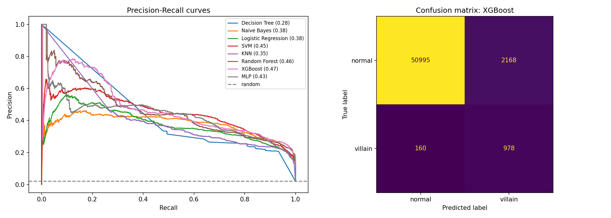
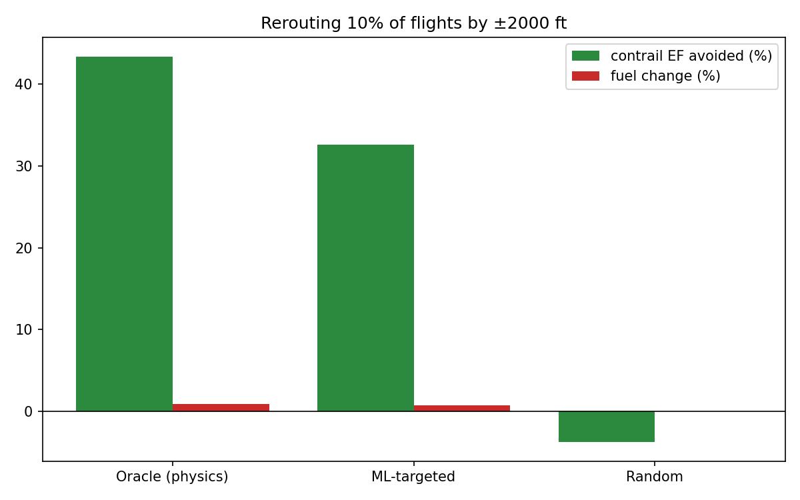
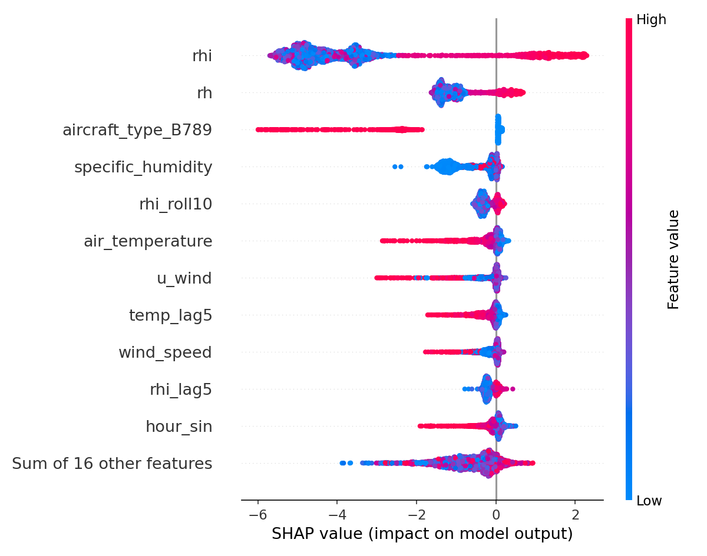
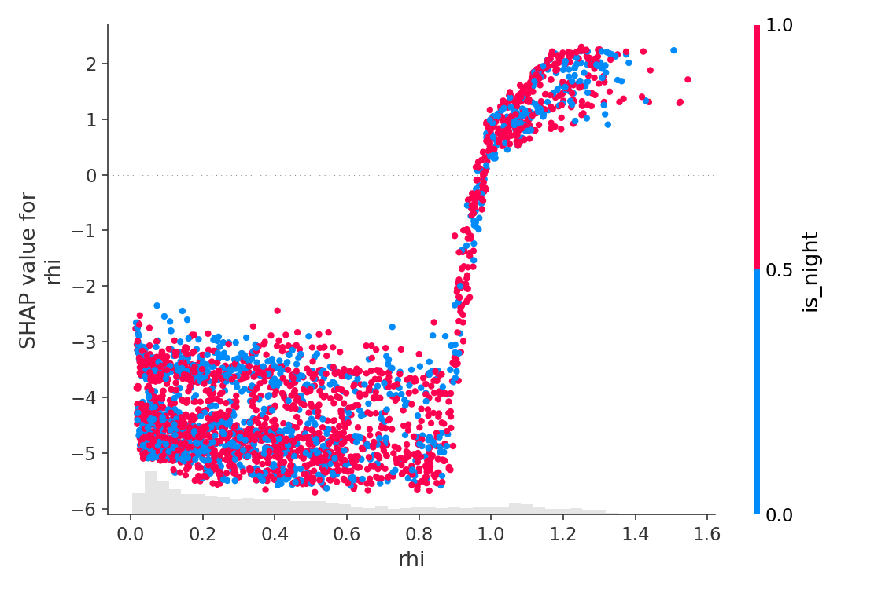

# Hunting the 2% Villain Flights: Machine Learning for Contrail Climate Impact

2107541 Machine Learning for Environmental Applications · Project 2

## Environmental problem

Aircraft condensation trails (contrails) can spread into thin cirrus clouds that trap outgoing heat. In 2018 the warming effect of contrail cirrus (57.4 mW/m²) was estimated to be larger than that of aviation's accumulated CO₂ (34.3 mW/m²) ([Lee et al., 2021](https://eprints.whiterose.ac.uk/165692/)), although the estimate is highly uncertain.

The effect is concentrated: about 2% of flights cause about 80% of contrail warming ([Teoh et al., 2020](https://spiral.imperial.ac.uk/handle/10044/1/78643); [Teoh et al., 2024](https://acp.copernicus.org/articles/24/6071/2024/)). Contrail-forming regions are usually thin layers of ice-supersaturated air, so small altitude changes on a few flights could avoid most of the warming. A live trial with American Airlines reduced contrails by 64% this way ([Sonabend-W et al., 2024](https://www.ncbi.nlm.nih.gov/pmc/articles/PMC11659620/)).

Physics-based contrail models such as CoCiP must simulate each contrail over its whole lifetime. That makes them too slow for real-time flight planning. This project trains fast, explainable ML models that flag the "villain" flight segments before take-off.

## Dataset source

| Component | Source | Notes |
| --- | --- | --- |
| Weather | [ERA5 reanalysis](https://www.ecmwf.int/en/forecasts/dataset/ecmwf-reanalysis-v5) via Google's public [ARCO-ERA5](https://github.com/google-research/arco-era5) store | 8 pressure levels (150–400 hPa), hourly, 0.5° grid, 8–14 Jan 2024 |
| Flights | Synthetic great-circle flights between 28 real airports in Europe and North America (700 routes, incl. North Atlantic) | 150 flights/day, FL300–FL400, 1-min waypoints; widebodies (A350, 777-300ER, 787-9, A330) on routes over 3,000 km |
| Labels | Contrail Cirrus Prediction model (CoCiP; [Schumann, 2012](https://gmd.copernicus.org/articles/5/543/2012/)) in [pycontrails](https://py.contrails.org/) | Energy forcing (EF) per waypoint; fuel from the PS aircraft performance model |

Final dataset: **263,045 flight segments, 27 columns**. A segment is labelled a **villain (1)** if it belongs to the smallest set of segments that together cause 80% of total positive EF (following Teoh et al.). Villains are **2.13%** of segments.

The data files are large, so they are not stored in this repository. Running `notebooks/01_data_preparation.ipynb` rebuilds them in Google Drive.

## Research questions

1. Can ML predict which flight segments will be villains from weather and flight conditions alone?
2. Which factors drive villain contrails?
3. If an airline may re-route 10% of flights by ±2,000 ft, how much contrail warming can ML-targeted re-routing avoid, and at what fuel cost?

## Methods

| Step | What was done | Course topic |
| --- | --- | --- |
| Preprocessing | Median imputation, scaling, local solar hour, day/night flag | L05 |
| Feature engineering | Along-track lags (RHi 5 min earlier, 10-min rolling mean), wind speed, sin/cos of hour, one-hot aircraft type | L05, L11 |
| Feature selection | Variance threshold, correlation filter (>0.95), mutual information, RFE | L10 |
| Split | 80/20 train/test **grouped by flight** (no waypoint of one flight in both sets) | L04 |
| Models (8) | Decision Tree, Naive Bayes, Logistic Regression, SVM, KNN, Random Forest, XGBoost, MLP | L02–L07, L12 |
| Imbalance | Class weights, or SMOTE inside the pipeline (NB, KNN, MLP) | L04 |
| Tuning | RandomizedSearchCV, GroupKFold (3 folds), scored by average precision | L04, L06 |
| Evaluation | PR-AUC (main), ROC-AUC, F1, precision, recall, confusion matrix | L04, L06 |
| Explainability | Permutation importance, SHAP (bar, beeswarm, dependence, waterfall), Explainable Boosting Machine | L10 |
| Unsupervised | PCA + K-Means (K chosen by silhouette) on weather of villain segments | L08, L09 |
| What-if | Re-ran CoCiP for 200 flights at ±2,000 ft; compared physics-oracle, ML-targeted and random re-routing; marginal abatement cost curve | — |

SVM and KNN were tuned on a 20,000-row subsample and Random Forest and MLP on 60,000 rows for speed. All models were evaluated on the same full test set. Random Forest, XGBoost and MLP were tuned with 20 random parameter sets; the other models were tuned with fewer.

## Main results

| Model | CV PR-AUC | Test PR-AUC | ROC-AUC | F1 | Precision | Recall |
| --- | --- | --- | --- | --- | --- | --- |
| **XGBoost** | 0.493 | **0.472** | 0.980 | 0.457 | 0.311 | 0.859 |
| Random Forest | 0.450 | 0.463 | 0.979 | 0.424 | 0.281 | 0.860 |
| SVM | 0.460 | 0.446 | 0.980 | 0.345 | 0.570 | 0.248 |
| MLP | 0.453 | 0.431 | 0.978 | 0.463 | 0.338 | 0.733 |
| Naive Bayes | 0.443 | 0.378 | 0.978 | 0.195 | 0.108 | 1.000 |
| Logistic Regression | 0.406 | 0.376 | 0.975 | 0.279 | 0.162 | 0.998 |
| KNN | 0.340 | 0.349 | 0.970 | 0.338 | 0.205 | 0.966 |
| Decision Tree | 0.349 | 0.280 | 0.939 | 0.351 | 0.220 | 0.867 |

A random guess has PR-AUC ≈ 0.021 (the villain rate), so the best model is about 22 times better than chance. Accuracy is not reported because predicting "normal" everywhere already scores 97.9%.



**What-if: re-routing 10% of flights (20 of 200) by ±2,000 ft**

| Strategy | Contrail EF avoided | Fuel change |
| --- | --- | --- |
| Oracle (physics knows the answer) | 43.4% | +0.88% |
| **ML-targeted (XGBoost)** | **32.6%** | **+0.73%** |
| Random | −3.7% (worse) | +0.03% |



## Best model

**XGBoost**, with test PR-AUC 0.472 and recall 0.86. It catches 86% of villain segments; the cost is false alarms (precision 0.31). For contrail avoidance this trade-off is acceptable, because a missed villain costs more warming than an unnecessary small altitude change costs fuel.

CV and test PR-AUC are close (0.493 vs 0.472), so the model is not overfitting.

## Feature importance



1. **Relative humidity over ice (RHi)** dominates every method (SHAP, permutation, mutual information, EBM).
2. **Aircraft type B789 (787-9)** strongly lowers the villain probability.
3. **Relative and specific humidity**, then **air temperature** and **wind**. Warmer air lowers the probability.
4. **Time of day:** villains are more common in the evening and at night (EDA histogram); `is_night` ranks third by mutual information.



## Environmental interpretation

- **The model re-discovered the physics.** The SHAP contribution of RHi jumps sharply at **RHi ≈ 1.0**, the ice-supersaturation threshold above which contrail ice crystals stop evaporating and persist for hours. The model was never told this rule.
- **Cleaner engines matter.** The 787-9 rarely produces villain contrails in this data. A plausible explanation is the lean-burn combustor of its GEnx engines, which emits far less soot. Fewer soot particles mean fewer, larger ice crystals and weaker, shorter-lived contrails. This is consistent with the "technology adoption" finding of Teoh et al. (2020). It comes from CoCiP's engine emission model, not from observation.
- **Night flights are riskier.** At night a contrail only traps heat; it cannot reflect sunlight. This is consistent with [Stuber & Forster (2007)](https://acp.copernicus.org/articles/7/3153/2007).
- **Targeting is the business case.** Re-routing 10% of flights chosen by ML avoided a third of contrail warming for under 1% more fuel. That is about 75% of what perfect physical knowledge achieves. Re-routing flights at random made warming slightly worse.

## Limitations

- Flight paths are synthetic (great circle, constant cruise altitude, no climb or descent). Real ADS-B trajectories (OpenSky) would be more realistic.
- Labels come from a physics model, not satellite observation. ERA5 humidity at cruise altitude is uncertain ([Platt et al., 2024](https://iopscience.iop.org/article/10.1088/2515-7620/ad6ee5)).
- One winter week over Europe and the North Atlantic; other seasons and regions may differ.
- EF is not converted to CO₂-equivalent, because conversion factors are highly uncertain. Fuel and carbon prices in the cost analysis are assumptions.

## Future work

- Train on real trajectories and fuel data (e.g. the [EUROCONTROL PRC 2025 Data Challenge](https://journals.open.tudelft.nl/joas/article/view/8750)).
- Validate labels with satellite contrail detections ([OpenContrails](https://arxiv.org/abs/2304.02122v2)).
- Test transfer to tropical airspace (Thailand/ASEAN; `REGION = "sea"` in notebook 01).

## Repository structure

```
Environmental-ML-Project/
├── README.md
├── data/                       # generated by notebook 01 (stored in Google Drive)
├── notebooks/
│   ├── 01_data_preparation.ipynb   # flights + ERA5 + CoCiP labels
│   ├── 02_modeling.ipynb           # 8 models, tuning, evaluation, XAI, clustering
│   └── 03_whatif_mac_curve.ipynb   # ±2,000 ft re-routing and cost curve
├── figures/
└── requirements.txt
```

The notebooks run on Google Colab (free tier) and read and write `MyDrive/Environmental-ML-Project/`.
